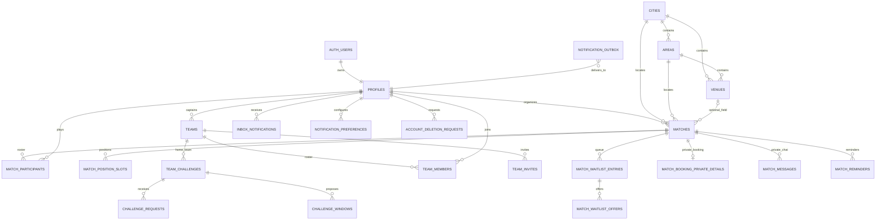

# ONE MORE schema overview

This is a navigation map of the current public schema, not a replacement for the ordered SQL migrations in `supabase/migrations/`. The migration files and generated `src/lib/database.types.ts` are the implementation sources of truth. Private booking details are intentionally separated from the public match row.

## Access and lifecycle boundaries

- `profiles`, preferences, teams, matches, roster, messages, challenges, notifications and deletion rows are protected by RLS or server-only grants. Client mutations use reviewed RPCs where the operation spans tables or enforces capacity.
- `match_discovery` is the limited public discovery surface; it must not expose roster identity, private booking notes, chat or waitlist identities.
- `match_booking_private_details` holds organizer-only booking reference and notes. `matches.notes` is public match copy, not a private booking field.
- `match_participants.status = active` is the confirmed roster. A pending join request is not a reservation. A waitlist offer reserves a vacancy only until expiry or explicit acceptance.
- `notification_outbox` and `match_reminders` are server-owned queues. Edge Functions send email; `inbox_notifications` supports the in-app inbox.
- An `account_deletion_requests` row is a request only. It does not delete the Auth user or their data; support must follow the runbook and applicable retention rules.

## Main migration areas

| Domain                       | Primary tables                                                                                  |
| ---------------------------- | ----------------------------------------------------------------------------------------------- |
| Identity and locale          | `profiles`, `user_preferences`, `cities`, `areas`, `venues`                                     |
| Matches and player lifecycle | `matches`, `match_participants`, `match_position_slots`, join requests, waitlist entries/offers |
| Team community               | `teams`, `team_members`, `team_invites`, `team_challenges`, challenge windows/requests          |
| Private match operations     | `match_booking_private_details`, `match_messages`, message reports                              |
| Delivery                     | `inbox_notifications`, `notification_preferences`, `notification_outbox`, `match_reminders`     |
| Privacy requests             | `account_deletion_requests`                                                                     |

Before changing relationships, read the relevant migration and pgTAP test. Apply schema changes only as a new migration; this diagram is not a manually editable schema.
